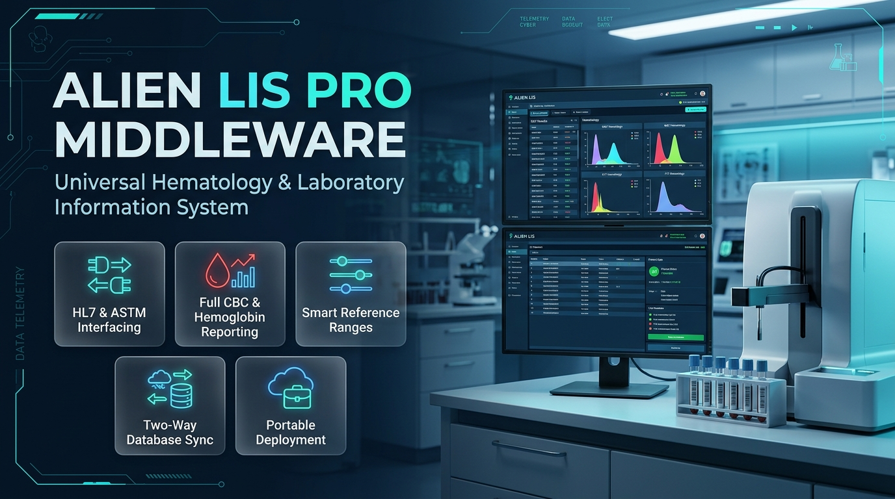

# Alien LIS Middleware Pro - Client Release & Distribution (v2.5)



[](https://microsoft.com)
[-512BD4.svg)](https://dotnet.microsoft.com)
[](https://aliensoftwaredevelopment.com)
[](https://aliensoftwaredevelopment.com)
[](https://aliensoftwaredevelopment.com)
[](https://wa.me/8801710978997)

---

## 📥 Direct Downloads

| Package Type | File Name | Size | Recommended For |
| :--- | :--- | :--- | :--- |
| **Windows Setup Installer** *(Recommended)* | [**`AlienLIS_Setup_v2.5.exe`**](AlienLIS_Setup_v2.5.exe) | **6.66 MB** | Hospital workstations, clinic PCs, full desktop & start menu integration |
| **Zero-Install Portable ZIP** | [**`AlienLIS_Portable_v2.5.zip`**](AlienLIS_Portable_v2.5.zip) | **5.69 MB** | USB Pen drives, quick testing, drop-in deployment without admin rights |
| **System Environment Health Checker** | [**`SystemHealthCheck.exe`**](SystemHealthCheck.exe) | **0.40 MB** | Standalone pre-flight verification of .NET, SQLite interop, ports, and offline readiness |

---

## ⚡ 100% Offline Guaranteed — Zero Internet Required

Alien LIS Middleware Pro is specifically engineered for **offline hospital and pathology lab environments**. When installed on a fresh, non-networked or internet-disconnected computer, **no additional runtime or driver installation is needed**:

* **Natively Pre-Installed .NET Target**: Targets .NET Framework 4.0 (`v4.0.30319`), which is built directly into Windows 8, 8.1, 10, 11, and Windows Server 2012–2025 out of the box.
* **Bundled Native SQLite Interop**: Includes both 32-bit (`x86`) and 64-bit (`x64`) native SQLite unmanaged C++ assemblies. Works instantly without Microsoft Visual C++ Redistributable packages.
* **100% Pure Managed Database Drivers**: Bundles pure managed Oracle (`Oracle.ManagedDataAccess.dll`) and pure managed MySQL (`MySql.Data.dll`) providers. No Oracle Instant Client, ODBC setup, or client configuration needed.
* **Zero External Dependencies**: All HL7 MLLP network socket listeners and RS-232 serial COM handlers operate using core Windows API components.

---

## 🩺 Post-Install Environment Health Verification

Every installation includes the **Alien LIS System Environment & Prerequisite Health Check** tool (`SystemHealthCheck.exe`). 

It runs automatically at the end of setup (or can be launched anytime from the Start Menu) to verify your machine:

```text
================================================================================
         ALIEN LIS MIDDLEWARE PRO - SYSTEM & PREREQUISITE HEALTH REPORT         
         Developer: Alien Software Development (https://aliensoftwaredevelopment.com)
================================================================================
[PASS] | System             | Operating System & Architecture | Windows 10/11 x64 Operational
[PASS] | .NET Runtime       | Microsoft .NET Framework       | Installed: .NET Framework 4.8.1+ (CLR v4.0.30319)
[PASS] | Database Engine    | SQLite Interoperability Engine | SQLite Core v3.46.1 32/64-bit Verified
[PASS] | Database Storage   | Local SQLite Database File     | Verified read/write access to Data\KT44_Database.db
[PASS] | Enterprise Drivers | Managed Database Providers     | Oracle & MySQL pure managed drivers verified
[PASS] | Connectivity       | HL7 MLLP TCP Port 5100         | Port 5100 is OPEN and available for Analyzer listener
[PASS] | Connectivity       | RS-232 Serial Port Subsystem   | Serial COM drivers functional
[PASS] | Portability        | 100% Offline Standalone Package | Zero internet or external installations required
================================================================================
OVERALL STATUS: SUCCESS - ALL PREREQUISITES VERIFIED FOR OFFLINE DEPLOYMENT
================================================================================
```

---

## 🚀 Quick Setup Guide (5 Minutes)

### Step 1: Install or Extract
* **Option A (Installer)**: Double-click `AlienLIS_Setup_v2.5.exe`. Follow the on-screen wizard to install to `C:\AlienLIS` (or your preferred folder). Desktop and Start Menu shortcuts will be created automatically.
* **Option B (Portable)**: Extract `AlienLIS_Portable_v2.5.zip` to any folder or USB pen drive. Run `Run_AlienLIS.bat`.

### Step 2: Connect Your Hematology Analyzer
* **LAN / Ethernet (HL7 TCP/IP)**: Connect your analyzer to the PC or local network switch using an RJ45 Ethernet cable. On the analyzer, configure destination IP to your PC's IP address and Port to `5100`.
* **Serial RS-232 Cable**: Connect the analyzer to your PC's COM port (or USB-to-RS232 adapter). Open Alien LIS Settings -> Interface -> Select COM Port & Baud Rate.

### Step 3: Run Tests & Print Reports
* Run a blood test on your analyzer. Results and histograms will appear in Alien LIS within milliseconds!
* Click **Print Dedicated HGB Report** for rapid pre-op / antenatal hemoglobin screening.
* Click **Print CBC Clinical Report** for complete 23+ parameter examination with WBC/RBC/PLT histogram curves.

---

## 🔬 Universal Analyzer Compatibility

Compatible with all standard 3-part and 5-part automated hematology analyzers:

* **Mindray**: BC-20, BC-30, BC-30s, BC-5000, BC-5150, BC-5380, BC-6000, BC-6200
* **Sysmex**: XP-100, XP-300, KX-21, KX-21N, XN-350, XN-550, XS-500i, XS-800i
* **Dymind**: DH36, DH76, DF50, DF52
* **Genrui**: KT-44, KT-6400, KT-6610, WP-330
* **Rayto**: RT-7600, RT-7200
* **URIT**: URIT-3000 Plus, URIT-5160
* **Dirui**: BCC-3000, BCC-3600, BF-6500
* **Zybio**: Z3, Z5
* **Abbott**: Cell-Dyn Emerald, Cell-Dyn Ruby, Cell-Dyn 3700
* **Beckman Coulter**: Ac·T diff, DxH 500, DxH 520

---

## 🎁 Licensing & Free Trial

* **7-Day Free Trial**: Full unrestricted trial with all features enabled upon first launch.
* **Lifetime Hardware-Locked License**: One-time purchase per computer with zero recurring monthly or annual fees. Offline activation via Machine ID.

---

## 📞 Customer Support & Inquiries

* **Developer**: Alien Software Development
* **Hotline / WhatsApp**: **+8801710978997** ([Click to chat on WhatsApp](https://wa.me/8801710978997))
* **Official Website**: [https://aliensoftwaredevelopment.com](https://aliensoftwaredevelopment.com)
* **GitHub Organization**: [https://github.com/alien-software-development](https://github.com/alien-software-development)
* **Office**: Dhaka, Bangladesh
